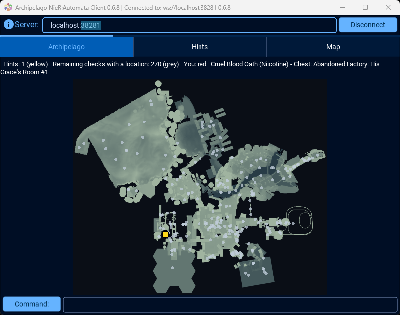

# NieR:Automata pour Archipelago

Monde Archipelago (`.apworld`) et client pour **NieR:Automata (PC Steam, v1.04)**, toutes les routes.
Le client lit et modifie la memoire du jeu en cours (aucun fichier du jeu n'est modifie).

## Installation
**Avec le lanceur** : telecharge `NierAutomataAP.exe` dans les Releases et lance-le. Il trouve Archipelago,
installe/met a jour le `.apworld` dans `custom_worlds`, puis ouvre le client NieR:Automata.
Un lien `archipelago://pseudo@serveur:port` peut lui etre passe (ou associe aux liens archipelago://).

**A la main** : copie `nier_automata.apworld` dans `<Archipelago>/custom_worlds`, puis
Launcher Archipelago -> *NieR:Automata Client*.

Prerequis : NieR:Automata **Steam v1.04** (la version Steam actuelle : la mise a jour de novembre 2026,
build Steam 26534214, il suffit de laisser Steam mettre le jeu a jour), Archipelago **0.6.8+**. Celui qui genere la partie doit aussi
avoir le `.apworld`. Modele de reglages : `NieR Automata.yaml`.

## Jouer
1. Lance le jeu et commence une **nouvelle partie** (une par seed).
2. Lance le client et connecte-toi. Les sauvegardes sont copiees dans `%LOCALAPPDATA%\NierAutomataAP\backups`.
3. Garde la fenetre du client ouverte : on y tape les commandes Archipelago (`!hint`, `!remaining`, chat...).

## Checks
Chaque check porte le nom de son lieu : un indice dit donc ou aller.
- **Story A 02-01: Landing at the City Ruins** : un check par chapitre de l'histoire (109 sur les routes A, B
  et C/D).
- **Chest: City Ruins #12** : chaque coffre, nomme d'apres sa zone. Les coffres verrouilles demandent 9S
  (a partir de la route B).
- **AP Item: Desert Zone: Housing Complex #2** : objets "AP Item" poses sur les points de collecte du jeu,
  1 a 8 par zone ; le ramasser affiche ce qu'il contient et pour qui.
- **Access Point: Desert: Camp** : premiere activation de chaque point d'acces.
- **Shop <lieu> #k** : "AP Item" vendus en tete des magasins (Camp de la Resistance, Village de Pascal,
  Chateau de la foret) ; la description dit ce qu'il contient et pour qui.
- **Level n**, **Weapon Found #n** : niveaux atteints, armes trouvees (retirees de l'inventaire).
- **Pod Program Found #n** : programmes de Pod obtenus dans le jeu lui-meme (magasin, quete, ramassage) ;
  comme les armes ils sont repris, on garde ceux envoyes par le multimonde (`pod_program_checks`, 0 = ne
  pas y toucher).
- **Ending A / B / C / D** : chaque fin principale atteinte avant l'objectif (`ending_checks`). La fin qui
  sert d'objectif n'est pas un check ; les fins "gag" ne le sont jamais.
- **Quest: <nom>** : terminer une quete annexe. La plupart se ferment apres le chapitre 7 (verifie en jeu) :
  elles ne contiennent jamais d'objet important ; le jeu donne toujours sa propre recompense.

## Objectifs et logique
- `goal` : `story_progress` (finir le chapitre N d'une route, partie courte), `ending_a`, `ending_b`, `ending_cd`,
  `ending_e`. L'objectif fixe la part du jeu qui a des checks.
- Les chapitres sont des regions logiques dans l'ordre de l'histoire. Les armes sont des objets de
  progression : les chapitres avances en demandent plus, donc elles arrivent avant les zones difficiles.
  Les checks de niveau suivent le niveau attendu par le jeu a chaque chapitre.
- Les checks ratables ou que beaucoup de joueurs ne trouvent jamais (Bunker, Village de Pascal, sous-sol
  de l'usine abandonnee, champ petrolifere et bords isoles du desert, zones de fin de route, quetes limitees
  dans le temps) ne contiennent jamais d'objet important.
- `starter_kit` (active par defaut) : quelques soins et un bonus d'attaque et de defense au depart, puis un
  ravitaillement donne une fois a l'entree des deux passages durs sans retour (les boss enchaines de la fin
  de la route A, et le debut de la route C/D).
- `area_locks` (active par defaut) : six zones restent fermees tant que tu n'as pas recu leur **Pass** : Desert,
  Parc d'attractions, Village de Pascal, Foret (avec le chateau), Ville inondee et Usine abandonnee. Y entrer
  sans le Pass te remet quelques metres en arriere, comme un mur invisible, avec "Ferme : Desert Pass" dans le
  journal du jeu. L'histoire passe par ces zones dans l'ordre, donc elle attend le Pass. Seules les zones jouees
  avant ton objectif ont un Pass (deux avec les reglages par defaut : Desert et Parc). Le prologue n'est jamais
  verrouille. La Ville copiee n'a pas de Pass (le jeu t'y place, on n'y entre pas a pied). Avec cette option les
  quetes annexes de la route A ne contiennent jamais d'objet important (certaines envoient dans une zone fermee).
- `route_locks` (active par defaut, ne sert que si ton objectif depasse la fin A) : la route B demande l'objet
  **Route B Access** et la route C/D l'objet **Route C/D Access**. Si tu commences une route sans son objet, le
  client te ramene au debut du chapitre 7 de la route que tu viens de finir (Village de Pascal, monde ouvert,
  quetes annexes encore ouvertes) pour que tu continues tes checks. Quand l'objet arrive, le client t'emmene
  tout seul au debut de la nouvelle route. Les deux deplacements sont des sauts de chapitre, comme le menu
  Chapter Select du jeu.
- `chapter_locks` (active par defaut, routes B et C/D seulement) : chaque grand chapitre apres le premier de la
  route demande une cle de plus (**B Chapter Key**, 9 au plus ; **C/D Chapter Key**, 6 au plus). Sans assez de
  cles, le client te ramene au debut de la derniere partie du chapitre precedent ; quand la cle arrive, il
  t'emmene au debut du chapitre attendu. La route A n'a pas de cle de chapitre : ses zones sont fermees par les
  Pass. Avec tous les verrous et la fin E en objectif, ca fait 23 verrous : 6 Pass, 2 objets de route, 15 cles.

## Objets recus
Armes, les 16 programmes de Pod autres que le laser de depart (`pod_programs`), capacites (double saut, dash
aerien, esquive au sol, tir du Pod, attaques...), soins et bonus, argent, et pieges :
- **Damage Trap / Heavy Damage Trap** : `damage_trap_percent` des PV max (5-50, defaut 20), le double pour
  le lourd. Ne tue jamais (1 PV au pire) sauf si `lethal_traps` est active.
- **Money Trap** : perte de 10 % des G.
- **Enemy Trap** : 3 machines d'un type deja present dans la zone apparaissent a cote du joueur, au niveau
  des machines de la zone.
  `enemy_trap_enemies` : `basic` (petites machines seulement) ou `random` (petites machines plus cinq types
  moyens essayes en jeu). Les boss et les grosses machines ne sont jamais copies. Si la zone n'a pas d'ennemi
  adapte, ou en contient deja une quarantaine (au-dela le jeu plantait), des degats a la place.
- **System Failure: Light Attack / Heavy Attack / Pod Fire** : ce systeme ne repond plus pendant 20 secondes.
- **Self-Destruct Trap** : l'autodestruction du jeu, court compte a rebours puis explosion, il reste 1 PV.
- **E-Drug Trap** : l'effet E-Drug du jeu, image et son brouilles pendant 30 secondes.

Les pieges qui utilisent les effets du jeu attendent tant qu'un menu ou un chargement est a l'ecran. Tous les
pieges sauf le Money Trap attendent la fin d'une cinematique (5 minutes au plus). Les courts mouvements de
camera scriptes qui ne sont pas de vraies cinematiques (une chute vers une nouvelle zone, par exemple) ne
sont pas detectes.

## En jeu
- Notifications : "De Niicotine : X", "Check : Camp Resistance" puis "Pour Niicotine : X".
- Messagerie (Courrier des points d'acces) : mail "Checks Archipelago" (checks restants) et mail
  "Indice de <joueur>" (indices demandes par les autres sur ta partie).
- DeathLink en option : une mort recue d'un autre joueur est une vraie mort dans le jeu (ecran de mort, retour a la derniere sauvegarde).

## Carte
Le client a un onglet **Map** : une carte du monde vue de dessus, construite a partir des collisions du jeu.
Les lieux donnes par un indice sont en jaune, tes checks restants qui ont un lieu precis en gris, et toi en
rouge. Les salles interieures et souterraines (grottes, usine, centre commercial...) sont en orange par-dessus
le monde ouvert. Molette pour zoomer, glisser pour deplacer.

Trois boutons en haut de l'onglet choisissent le niveau affiche : **All** (tout sur une image), **Surface**
(le monde ouvert seul, avec ses checks) et **Indoor / underground** (les cartes separees et les souterrains :
grottes, Ville copiee, sous-sol de l'usine, Tour... avec leurs checks, le monde ouvert assombri en repere).
Sans ca, un check sous terre se confond avec ce qui est en surface au meme endroit.

## Limites connues
- Uniquement Steam v1.04, c'est-a-dire la version Steam actuelle (mise a jour de novembre 2026, build
  26534214). La version d'avant cette mise a jour n'est pas geree : le client affiche "Unknown NieRAutomata.exe
  version" et ne fait rien.
- Teste en jeu sur les trois routes par sauts de chapitre automatiques et captures d'ecran (`tools/`) :
  checks d'histoire de chaque chapitre, les 182 coffres retrouves a la position prevue (interieurs compris), AP Items poses a
  leur emplacement, achats dans les trois magasins, points d'acces, objectifs des fins A a E, et checks de
  quete (une quete annexe jouee pour de vrai : acceptee, objets livres, ecran de recompense, check parti). Un coffre verrouille a ete ouvert avec 9S par un robot qui joue le mini-jeu de piratage, et son check
  est parti. Les coffres qui n'existent que pendant ou apres une quete annexe ne contiennent jamais d'objet
  important. Le marchand de la foret n'existe qu'apres la
  quete annexe ratable "Camp Development" : ses AP Items ne contiennent jamais d'objet important.
- Les pieges Self-Destruct et E-Drug ont ete essayes a pied avec 2B, en combat de boss (les deux
  marchent), en sequence de vol et pendant un piratage de 9S (l'E-Drug s'y affiche ; le Self-Destruct attend
  le retour a pied, et les objets recus apres lui attendent avec lui).
- Zones verrouillees : essayees en jeu a l'entree de chacune des six zones (le mur tient sur des essais repetes,
  et le Desert s'ouvre des que son Pass arrive du serveur). Si tu te connectes alors que tu es deja dans une zone
  fermee, le client te laisse la. Aucune partie complete n'a encore ete jouee avec les verrous.
- Routes verrouillees : essayees en jeu pour les routes B et C/D (retour en arriere sans l'objet, route lancee
  quand l'objet arrive du serveur, premier check de la route envoye). Le message "Ferme" d'une route n'a pas
  encore ete vu a l'ecran. Essaye en sautant au debut de chaque route, pas en jouant une vraie fin.
- Chapitres verrouilles : essayes en jeu sur un chapitre de la route B et un de la route C/D (retour en arriere
  sans la cle, chapitre lance quand la cle arrive, son check envoye). Les autres chapitres utilisent le meme code
  et des debuts de chapitre deja atteints par saut pendant la campagne de test, mais chaque verrou n'a pas ete
  essaye un par un.
- Titres des mails : ouvrir un point d'acces ~10 s la premiere fois apres chaque lancement du jeu.
- Ne pas charger une autre sauvegarde que celle de la seed.

## Developpement
- Tests : `python -m pytest`
- Build : `python build.py` (apworld) ; lanceur : `python launcher/build_exe.py`
- Outils de retro-ingenierie dans `tools/` (sondes memoire, points d'arret materiels, lecture CPK/BXM/MCD).
