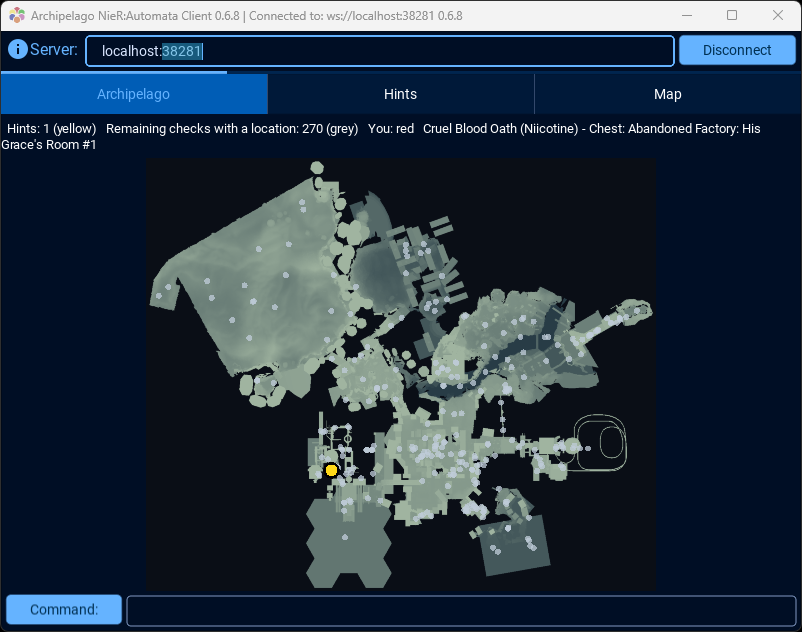

# NieR:Automata for Archipelago

Archipelago world (`.apworld`) and client for **NieR:Automata (PC Steam, v1.04)**, all routes.
The client reads and edits the running game's memory (no game file is modified). In-game texts follow the
game language (English by default, French supported). [Version francaise](README.fr.md)

## Install
**With the launcher**: download `NierAutomataAP.exe` from the Releases and run it. It finds Archipelago,
installs/updates the `.apworld` in `custom_worlds`, then opens the NieR:Automata client.
You can pass it an `archipelago://name@server:port` link.

**Manually**: copy `nier_automata.apworld` into `<Archipelago>/custom_worlds`, then
Archipelago Launcher -> *NieR:Automata Client*.

Requirements: NieR:Automata **Steam v1.04** (the current Steam version: the November 2026 update, Steam
build 26534214, so just let Steam update the game), Archipelago **0.6.8+**. Whoever generates the game also needs the
`.apworld`. Settings template: `NieR Automata.yaml`.

## Playing
1. Start the game and begin a **new game** (one per seed).
2. Start the client and connect. Saves are backed up to `%LOCALAPPDATA%\NierAutomataAP\backups`.
3. Keep the client window open: Archipelago commands (`!hint`, `!remaining`, chat...) are typed there.

## Checks
Everything is named after where it is, so a hint tells you where to go.
- **Story A 02-01: Landing at the City Ruins**: one check per story chapter (109 over routes A, B and C/D).
- **Chest: City Ruins #12**: every chest, named after its area. Hack-locked chests need 9S (route B on).
- **AP Item: Desert Zone: Housing Complex #2**: "AP Item" objects placed on the game's own collection points,
  1 to 8 per area; picking one up shows what it contains and for whom.
- **Access Point: Desert: Camp**: first activation of each access point.
- **Shop <place> #k**: "AP Item" entries at the top of the shops (Resistance Camp, Pascal's Village,
  Forest Castle); the description says what's inside and for whom.
- **Level n**, **Weapon Found #n**: levels reached, weapons found (removed from the inventory).
- **Pod Program Found #n**: Pod programs obtained in the game itself (shop, quest, pickup); like weapons they
  are taken back, you keep the ones the multiworld sends (`pod_program_checks`, 0 = leave them alone).
- **Ending A / B / C / D**: each main ending reached before the goal (`ending_checks`). The goal ending is
  not a check; joke endings are never checks.
- **Quest: <name>**: finishing a side quest. Most quests close after chapter 7 (checked in game), so they
  never hold an important item; the game still gives its own reward.

## Goals and logic
- `goal`: `story_progress` (finish chapter N of a route, short game), `ending_a`, `ending_b`, `ending_cd`, `ending_e`.
  The goal sets how much of the game has checks.
- Chapters are logic regions in story order. Weapons are progression items: later chapters expect more of
  them, so the weapons you need arrive before the harder areas. Level checks follow the level the game
  expects in each chapter.
- Checks that can be missed or that many players never find (Bunker, Pascal's Village, the Abandoned
  Factory underground, the desert Oil Field and its far edges, late-route areas, timed quests) never hold
  an important item.
- `starter_kit` (on by default): a few recovery items and one attack and one defense boost at the start,
  then a supply drop once when you enter the two hard sections you cannot come back from (the boss rush at
  the end of route A, and the start of route C/D).
- `area_locks` (`up_to_forest` by default, `all`, `off`): areas are closed until you receive their **Pass**:
  Desert Zone, Amusement Park, Pascal's Village and Forest Zone (with the castle); with `all`, also Flooded City
  and Abandoned Factory (these two come after chapter 7, when side quests are closed, so waiting there leaves
  little to do). Walking in without
  the Pass puts you back a few meters, like an invisible wall, with "Locked: Desert Pass" in the game log. The
  story needs these areas in order, so it waits for the Pass. Only the areas played before your goal get a Pass
  (two with the default settings: Desert and Park). The prologue is never locked. The Copied City has no Pass
  (the game places you inside, you do not walk in). With this option the route A side quests never hold an
  important item (some of them send you into a closed area).
- `route_locks` (on by default, only used when your goal goes past ending A): route B needs the **Route B
  Access** item and route C/D the **Route C/D Access** item. If you start a route without its item, the client
  takes you back to the start of chapter 7 of the route you just finished (Pascal's Village, open world, side
  quests still open) so you can keep doing checks. When the item arrives, the client takes you to the start of
  the new route by itself. Both moves are chapter jumps, like the game's own Chapter Select.
- `chapter_locks` (on by default, routes B and C/D only): each big chapter after the first one of the route
  needs one more key (**B Chapter Key**, up to 9; **C/D Chapter Key**, up to 6). Without enough keys the client
  takes you back to the start of the last part of the previous chapter; when the key arrives it takes you to the
  start of the chapter you were waiting for. Route A has no chapter keys: its areas are closed by the Passes.
  With ending E as the goal that is 24 locks by default (4 Passes, 2 route items, 15 chapter keys, 3 Tower keys),
  26 with `area_locks: all`.
- `tower_keys` (on by default, only used when your goal reaches the Tower: ending C/D or E): the three Access
  Keys of route C/D (**Forest**, **Ocean**, **Park Access Key**) come from the multiworld. The client takes back
  the ones the game gives you and hands them over when they arrive. Without the three keys the Tower door pushes
  9S away and cannot be hacked.

## Items received
Weapons, the 16 Pod programs other than the starting laser (`pod_programs`), abilities (double jump, air
dash, ground evade, pod fire, attacks...), recovery items and boosts, money, and traps:
- **Damage Trap / Heavy Damage Trap**: `damage_trap_percent` of max HP (5-50, default 20), twice for the
  heavy one. Never kills (1 HP at worst) unless `lethal_traps` is on.
- **Money Trap**: lose 10% of your money.
- **Enemy Trap**: 3 machines of a type already present in the area appear next to you, at the level of
  the area's own machines. `enemy_trap_enemies`:
  `basic` (small machines only) or `random` (small machines plus five medium types tried in game). Bosses
  and big machines are never copied. If the area has no suitable enemy, or already holds about 40 enemies
  (more made the game crash), you take damage instead.
- **System Failure: Light Attack / Heavy Attack / Pod Fire**: that system stops answering for 20 seconds.
- **Self-Destruct Trap** (`self_destruct_trap`: `rare` by default, `normal`, `off`): the game's own self-destruct, short countdown then explosion, leaves you at 1 HP.
- **E-Drug Trap**: the game's E-Drug effect, picture and sound scrambled for 30 seconds.

Traps that use the game's own effects wait while a menu or a loading screen is up. Every trap except the Money
Trap waits for the end of a cutscene (5 minutes at most). Short scripted camera moves that are not real
cutscenes (a fall into a new area, for example) are not detected.

## In game
- Notifications: "From X: item", "Check: Resistance Camp" then "For X: item".
- Mail (access point Mail menu): "Archipelago checks" (remaining checks, with a count per kind) and "Hint from <player>"
  (hints other players requested on your world).
- Optional DeathLink: a death received from another player is a real death in the game (death screen, respawn at your last save).

## Map
The client has a **Map** tab: a top-down map of the world built from the game's own collision data. Hinted
locations are yellow, your remaining checks that have a precise location are grey, and you are the red dot.
Indoor and underground rooms (caves, factory, shopping center...) are drawn in orange over the open world.
Scroll to zoom, drag to move.

Three buttons at the top of the tab pick the level shown: **All** (everything on one picture), **Surface** (the
open world alone, with its checks) and **Indoor / underground** (the separate maps and what is below ground:
caves, Copied City, factory underground, Tower... with their checks, the open world dimmed as a guide). Without
this, an underground check looks the same as whatever is above it on the surface.

## Known limits
- Steam v1.04 only, which is the current Steam version (November 2026 update, build 26534214). The version
  from before that update is not supported: the client says "Unknown NieRAutomata.exe version" and does nothing.
- Tested in game on all three routes with automated chapter jumps and screen captures (`tools/`): story
  checks for every chapter, all 182 chests found at their expected position (interior rooms included), ground AP Items placed on their
  spots, purchases in the three shops, access points, the goals for endings A to E, and quest checks (one side quest played for real: accepted, items delivered,
  reward screen, check sent). A hack-locked chest was opened as 9S by a bot playing the hacking minigame, and its check was sent.
  Chests that only exist during or after a side quest never hold an important item. The forest shop only exists after the missable
  side quest "Camp Development", so its AP Items never hold an important item.
- The Self-Destruct and E-Drug traps were tried on foot as 2B, in a boss fight (both work), in a flying section
  and during a 9S hack (E-Drug shows there; Self-Destruct waits until you are back on foot, and the items
  received after it wait with it).
- Area locks: tested in game at the entrance of each of the six areas (the wall holds on repeated tries, and the
  Desert opens as soon as its Pass arrives from the server). If you connect while already standing inside a
  closed area, the client leaves you there. No full playthrough with the locks has been done yet.
- Route locks: tested in game for routes B and C/D (taken back without the item, route started when the item
  arrives from the server, first check of the route sent). The "Locked" message of a route lock has not been
  seen on screen yet. Tested by jumping to the start of each route, not by playing an ending for real.
- Chapter locks: tested in game on one chapter of route B and one of route C/D (taken back without the key,
  chapter started when the key arrives, its check sent). The other chapters use the same code and the chapter
  starts already reached by jump during the test campaign, but each lock has not been tried one by one.
- Tower keys: tested in game in front of the Tower with the real client and a server (no key: the door refuses;
  keys taken back when put in the inventory; keys sent by the server: 9S hacks the door and the story goes on).
  The moment the game itself hands a key (end of each resource unit) has not been played.
- Mail titles: open an access point for ~10 s the first time after each game launch.
- Don't load another save than the one of the seed.

## Development
- Tests: `python -m pytest`
- Build: `python build.py` (apworld); launcher: `python launcher/build_exe.py`
- Reverse-engineering tools in `tools/`; game data research (routes, endings, quests, chests, positions) in
  `docs/research/`.
